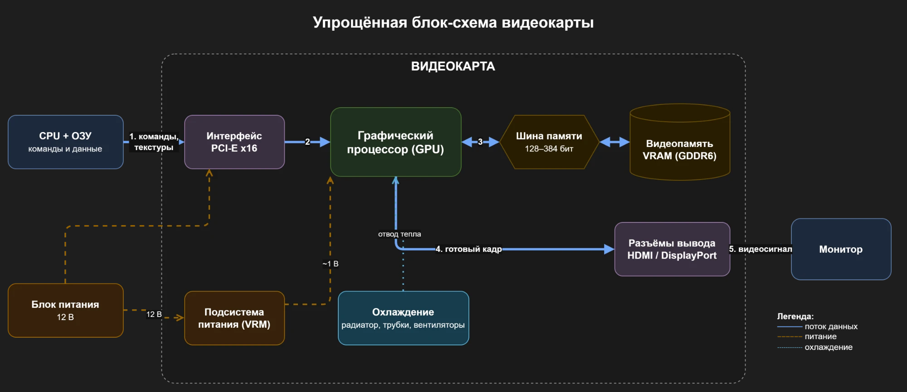

# Домашнее задание: видеокарта (GPU)

---

## Часть 1. Теория

### 1. Пять основных блоков видеокарты

| № | Блок | Назначение |
|---|------|------------|
| 1 | **Графический процессор (GPU)** | Выполняет вычисления: геометрию, шейдеры, растеризацию, а также общие расчёты (CUDA/OpenCL) |
| 2 | **Видеопамять (VRAM)** | Хранит текстуры, модели, буферы кадров и промежуточные данные, с которыми работает GPU |
| 3 | **Подсистема питания (VRM)** | Преобразует 12 В от БП и PCI-E в низкие стабильные напряжения для GPU и памяти |
| 4 | **Система охлаждения** | Радиатор, тепловые трубки и вентиляторы отводят тепло от GPU, памяти и VRM |
| 5 | **Интерфейсы (PCI-E и видеовыходы)** | PCI-E связывает карту с процессором и ОЗУ, а HDMI и DisplayPort выводят изображение на монитор |

### 2. Отличия GPU от CPU по архитектуре

1. **Количество и сложность ядер.** У CPU мало ядер (4–24), но каждое мощное: высокая частота, предсказание ветвлений, внеочередное исполнение. У GPU тысячи простых ядер.
   - CPU выгоден для **последовательных задач со сложной логикой и ветвлениями**: ОС, игровая логика, компиляция, базы данных.
   - GPU выгоден для **массово-параллельных однотипных вычислений**: обработки пикселей, матричных операций, рендеринга, обучения нейросетей.

2. **Оптимизация под задержку или под пропускную способность.** CPU снижает задержку одной операции с помощью большого кэша (L1–L3) и сложного управления. GPU увеличивает общую пропускную способность: он скрывает задержки памяти, переключаясь между тысячами потоков, а его память очень быстрая.
   - CPU нужен там, где важен **быстрый ответ на одну задачу**, например в интерактивной работе и при обработке прерываний.
   - GPU нужен там, где важно **обработать огромный объём данных целиком**: кадр 4K, видео, большие нейросети.

### 3. VRAM и её отличие от ОЗУ

**VRAM** — это собственная память видеокарты, распаянная на плате рядом с GPU. В ней хранятся текстуры, геометрия, буферы кадров и веса нейросетей.

| | VRAM (GDDR6/GDDR6X/HBM) | ОЗУ (DDR4/DDR5) |
|---|---|---|
| Где находится | На плате видеокарты, рядом с GPU | В слотах материнской платы |
| Кто использует | Только GPU | CPU (и все программы) |
| Ширина шины | 128–384 бит (HBM — до 4096+) | 64 бит на канал |
| Пропускная способность | ~250–1000+ ГБ/с | ~50–100 ГБ/с |
| Приоритет | Пропускная способность | Низкая задержка |
| Заменяемость | Распаяна, не меняется | Модули можно заменить |

**Почему видеопамять делают максимально быстрой:** тысячи ядер GPU обращаются к памяти одновременно. При частоте 60–144 кадров в секунду каждый кадр требует чтения гигабайт текстур и буферов. Если память не успевает подавать данные, ядра простаивают, и производительность упирается в память.

### 4. SIMT и варпы

**SIMT (Single Instruction, Multiple Threads)** означает «одна инструкция — много потоков». GPU выдаёт одну команду, например «сложи A и B», и её одновременно выполняют сразу много потоков, каждый над своими данными: над своим пикселем, своей вершиной или своим элементом массива.

**Зачем потоки группируются в варпы.** У NVIDIA варп состоит из 32 потоков, у AMD аналогичная группа называется wavefront и содержит 32 или 64 потока. Причины такие:
- **Экономия на управлении.** Один блок выборки и декодирования инструкций обслуживает сразу 32 потока. Так в чип помещается гораздо больше вычислительных ядер.
- **Скрытие задержек.** Пока один варп ждёт данные из памяти, планировщик мгновенно переключается на другой, готовый к работе варп, и ядра не простаивают.
- **Эффективный доступ к памяти.** Соседние потоки варпа обычно читают соседние адреса, и эти запросы объединяются в одну широкую транзакцию.

Минус SIMT — **ветвления (divergence)**. Если внутри одного варпа потоки пошли по разным веткам `if/else`, ветки выполняются по очереди, и часть потоков в это время простаивает.

### 5. Охлаждение и подсистема питания

- **Подсистема питания (VRM)** нужна потому, что GPU требует низкого напряжения (~0,7–1,1 В) при очень большом токе (сотни ампер). Многофазный VRM преобразует 12 В в нужное напряжение, сглаживает пульсации и мгновенно реагирует на скачки нагрузки. Без этого GPU работал бы нестабильно.
- **Охлаждение** нужно потому, что видеокарта выделяет 100–450 Вт тепла. Это тепло нужно отводить, чтобы чип работал в допустимом диапазоне температур (обычно до ~83–90 °C).

**Если охлаждение не справится:**
1. Сначала включается **троттлинг**: GPU снижает частоты и напряжение, и FPS падает.
2. Дальше могут появиться артефакты, вылеты драйвера и зависания.
3. При критической температуре срабатывает **аварийное отключение**: экран гаснет, ПК перезагружается.
4. При длительном перегреве **ресурс компонентов сокращается**: деградируют чип, память и конденсаторы VRM, а на старых картах отваливались BGA-пайки.

---

## Часть 2. Схема

Упрощённая блок-схема видеокарты. Стрелки показывают путь данных от CPU к монитору.

Схема нарисована в draw.io (файл `схема_gpu.drawio`):



---

## Часть 3. Практика

### 1. Моя видеокарта

Модель определена командой `nvidia-smi`:

```
> nvidia-smi --query-gpu=name,memory.total,power.limit,clocks.max.memory --format=csv
NVIDIA GeForce RTX 4060 Ti, 8188 MiB, 160.00 W, 9001 MHz
```

| Характеристика | Значение |
|---|---|
| Модель | **NVIDIA GeForce RTX 4060 Ti** (чип AD106, архитектура Ada Lovelace) |
| Объём VRAM | **8 ГБ** |
| Тип памяти | **GDDR6** |
| Ширина шины | **128 бит** |
| Число ядер CUDA | **4352** |
| TDP | **160 Вт** |
| Интерфейс | PCI-E 4.0 x8 |

### 2. Пропускная способность памяти

Формула: **частота памяти (МГц) × ширина шины (бит) / 8**

`nvidia-smi` показывает частоту памяти **9001 МГц**. GDDR6 передаёт данные с удвоенной скоростью, поэтому **эффективная частота равна 9001 × 2 ≈ 18 000 МГц** (18 Гбит/с на контакт).

```
18 000 МГц × 128 бит / 8 = 288 000 МБ/с ≈ 288 ГБ/с
```

| | Значение |
|---|---|
| Расчётное | **≈ 288 ГБ/с** |
| Паспортное (NVIDIA) | **288 ГБ/с** |

Расчёт совпал с паспортным значением.

> Если подставить частоту 9001 МГц напрямую, получится ~144 ГБ/с, то есть ровно в 2 раза меньше. Значит, в формулу нужно подставлять эффективную частоту памяти.
>
> Для сравнения: у двухканальной DDR5-6000 пропускная способность около 96 ГБ/с, то есть в 3 раза меньше.

### 3. От нажатия «запустить игру» до картинки на экране

1. **Запуск (CPU, диск, ОЗУ).** ОС загружает исполняемый файл игры с SSD в ОЗУ, а CPU начинает выполнять её код.
2. **Инициализация графики (CPU).** Игра через API (DirectX, Vulkan или OpenGL) обращается к драйверу видеокарты, создаёт устройство, буферы и окно вывода.
3. **Загрузка ресурсов (CPU, PCI-E, VRAM).** Текстуры, модели и шейдеры читаются с диска в ОЗУ. CPU распаковывает их и по шине PCI-E передаёт в **VRAM**. Шейдеры драйвер компилирует в машинный код GPU.
4. **Подготовка кадра (CPU).** В каждом кадре CPU обрабатывает ввод игрока, физику, ИИ врагов и логику. Затем он определяет, какие объекты видны, и формирует **команды отрисовки (draw calls)**. Драйвер упаковывает их в буфер команд и отправляет на GPU.
5. **Обработка геометрии (GPU, VRAM).** GPU читает вершины из VRAM, а вершинные шейдеры переводят их в экранные координаты.
6. **Растеризация (GPU).** Треугольники разбиваются на фрагменты (будущие пиксели).
7. **Пиксельные шейдеры (GPU, VRAM).** Тысячи ядер параллельно вычисляют цвет каждого пикселя: читают текстуры из VRAM, считают освещение и тени. На RTX-картах могут дополнительно работать RT-ядра (трассировка лучей) и тензорные ядра (DLSS).
8. **Постобработка и запись кадра (GPU, VRAM).** Применяются эффекты (сглаживание, размытие, HDR), и готовый кадр записывается в **буфер кадра** во VRAM.
9. **Вывод (GPU, монитор).** После смены буферов (swap, V-Sync/G-Sync) контроллер дисплея передаёт кадр через HDMI или DisplayPort на **монитор**.
10. **Повтор.** Шаги 4–9 повторяются 60–144+ раз в секунду. Пока GPU рисует текущий кадр, CPU уже готовит следующий.

---

## Часть 4. Вывод

Видеокарты создавались для графики, где миллионы пикселей обрабатываются одинаковыми операциями независимо друг от друга, поэтому GPU устроен как тысячи простых ядер, работающих параллельно. Обучение и работа нейросетей по сути состоят из того же: огромного количества однотипных умножений матриц и векторов, которые тоже легко распараллелить. CPU с его несколькими мощными ядрами выполняет такие операции по очереди, а GPU — тысячами одновременно, да ещё с очень быстрой памятью, которая успевает подавать данные. Поэтому на GPU обучение моделей ускоряется в десятки и сотни раз, а NVIDIA добавила в карты специальные тензорные ядра именно для ИИ. Получается, что видеокарта подходит не только для игр, а для любых массово-параллельных вычислений, и ИИ — главная из таких задач.
