# Отчёт: 10 задач по BIOS/UEFI в Lenovo BIOS Simulator Center

Симулятор: https://download.lenovo.com/bsco/index.html

Устройство: ThinkPad T14s Gen 5, графический режим.

---

## Задача 1. Навигация по основным разделам

Открыл по очереди разделы Main, Config, Date/Time, Security, Startup, Restart.

В Main отображается:
- UEFI BIOS Version: N46ET09W
- UEFI BIOS Date: 2024-01-22
- Machine Type Model: 21LS
- System-unit serial number: PF12345
- System board serial number: L112345678
- CPU Type: Intel(R) Core(TM) CPU
- CPU Speed: 1.X00GHz
- Installed memory: 8192MB
- UEFI Secure Boot: On

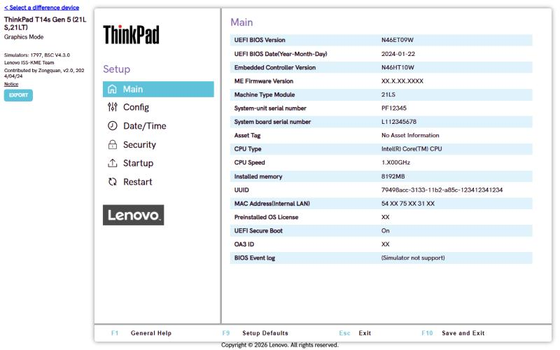

Config: Network, USB, Keyboard/Mouse, Display, Power, Beep and Alarm, CPU, Thunderbolt 4, Intel AMT.

Date/Time: системные дата и время.

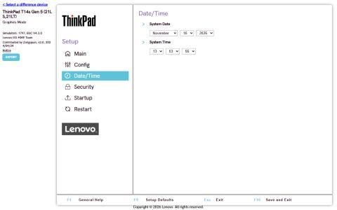

Security: Password, Fingerprint, Security Chip, Virtualization, Secure Boot и другие.

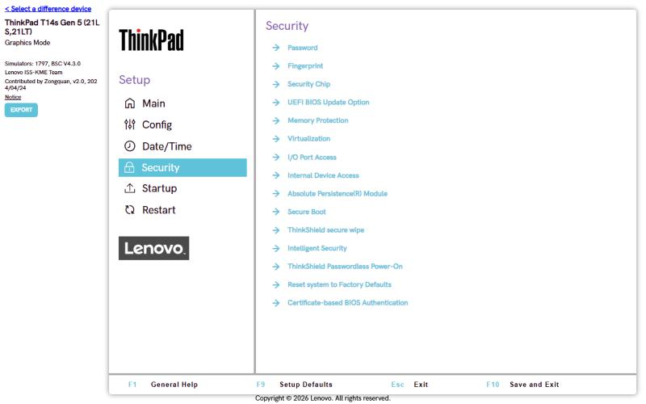

Startup: Boot, Network Boot, Boot Mode, Option key Display, Boot device List F12 Option, Boot Order Lock.

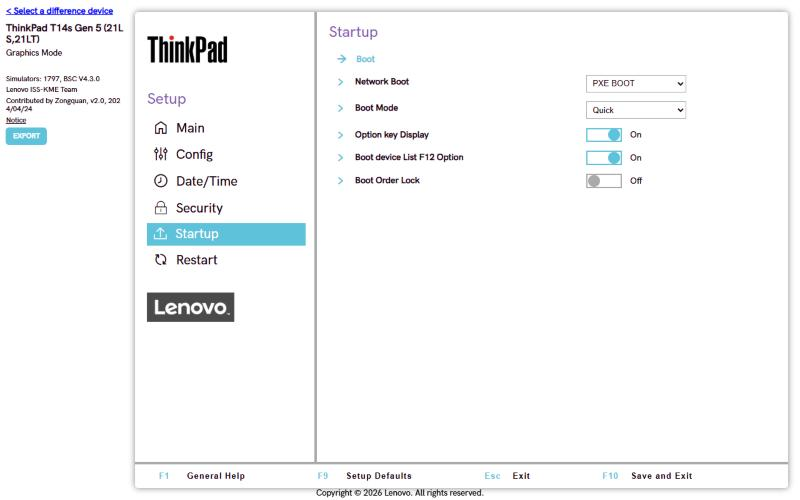

Restart: Exit Saving Changes, Exit Discarding Changes, Load Factory Defaults и другие.

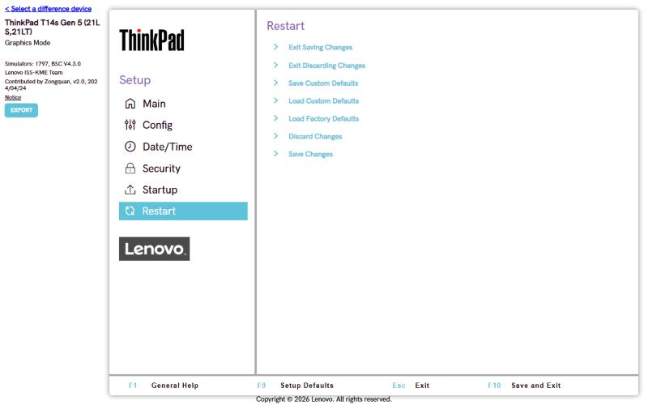

Где находятся настройки из задач 2–5:
- порядок загрузки: Startup
- Secure Boot: Security
- пароль супервизора: Security
- сброс настроек: Restart

---

## Задача 2. Смена порядка загрузки

Путь: Startup -> Boot

Исходный порядок:

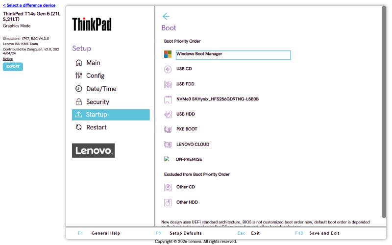

Перетащил USB HDD на первое место, NVMe0 на второе:

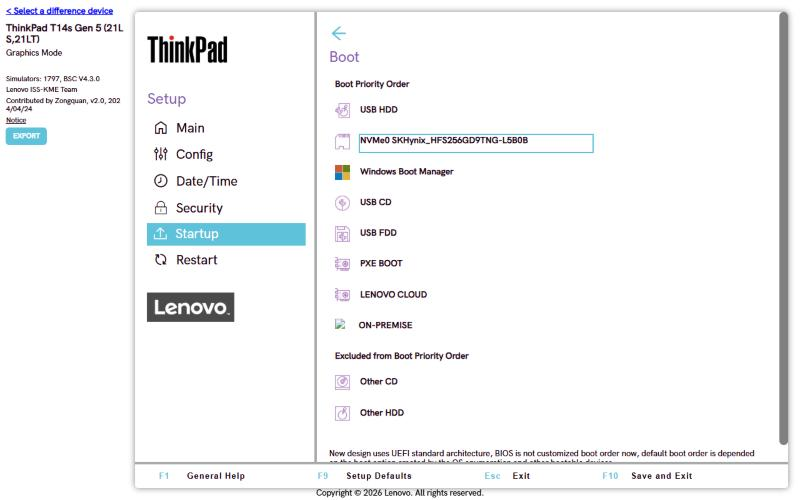

Нажал F10 и подтвердил сохранение:

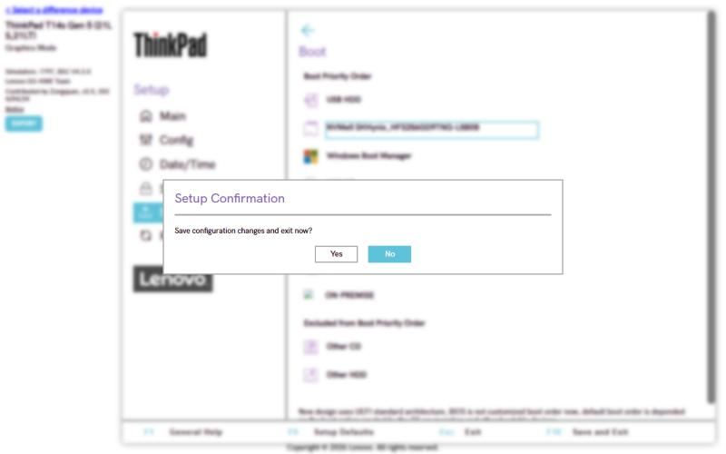

После повторного входа порядок сохранился:

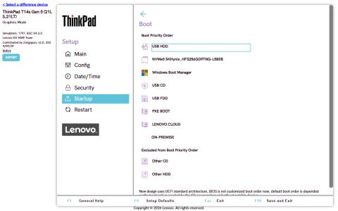

---

## Задача 3. Включение/выключение Secure Boot

Путь: Security -> Secure Boot -> Secure Boot

Исходный статус On:

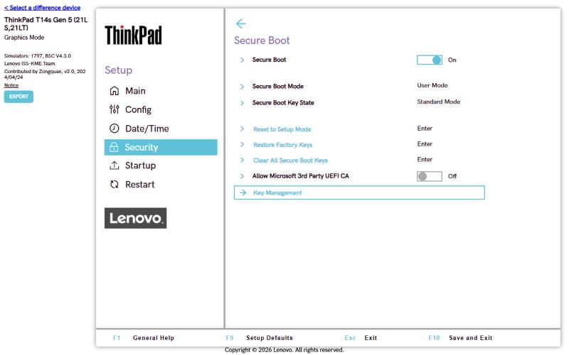

Переключил в Off:

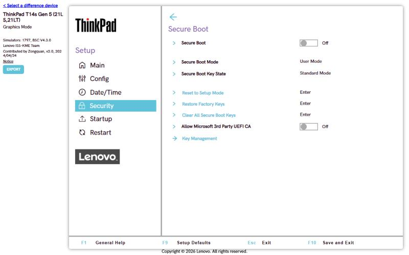

Вернул в On:

Перезагрузка сразу не требуется, изменение применяется после сохранения через F10.

Secure Boot проверяет цифровую подпись загрузчика ОС и не даёт запустить неподписанный или подменённый загрузчик. Это защита от буткитов и руткитов.

---

## Задача 4. Установка пароля супервизора

Путь: Security -> Password -> Supervisor Password

Исходно пароль не установлен:

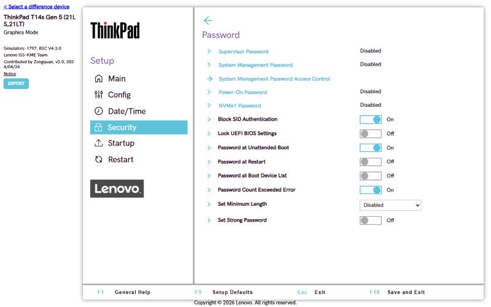

Ввёл пароль Test1234 и подтверждение:

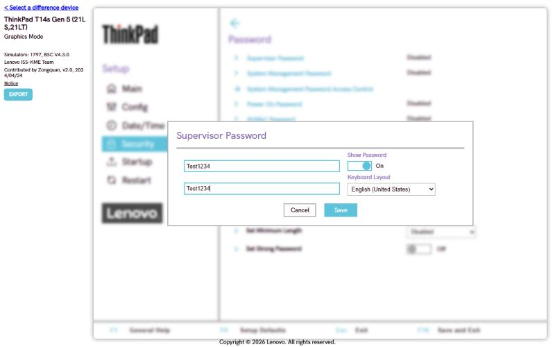

Статус изменился на Enabled:

Изменил другую настройку. Запрос пароля в симуляторе не появился, симулятор это не эмулирует. На реальном ноутбуке пароль запрашивается при входе в BIOS.

Попытался снять пароль, оставив поля пустыми. Симулятор не принимает пустой пароль:

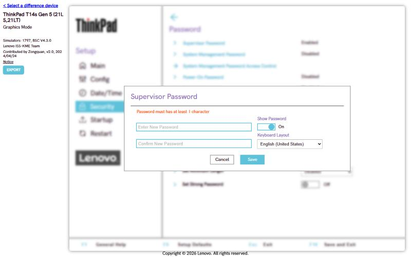

Пароль снят через Restart -> Load Factory Defaults, см. задачу 5.

---

## Задача 5. Сброс на заводские настройки

Путь: Restart -> Load Factory Defaults. Также есть клавиша F9.

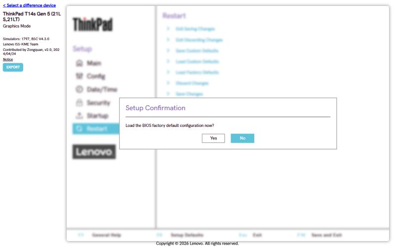

Порядок загрузки вернулся к исходному:

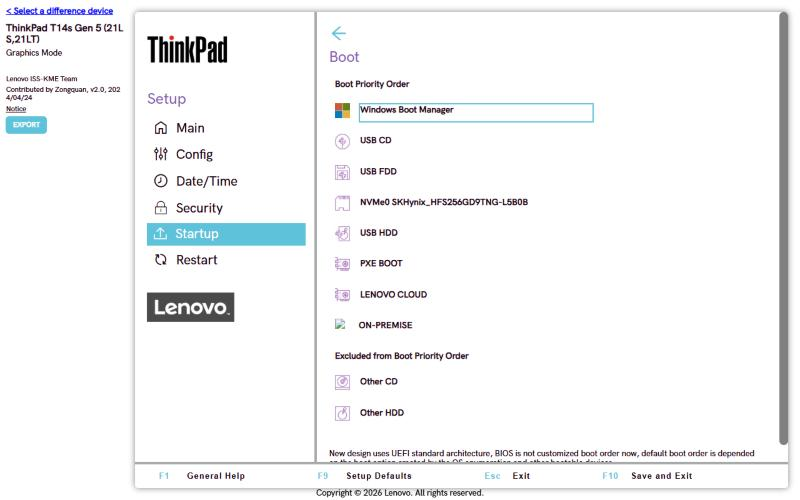

Пароль супервизора снят, Secure Boot включён:

---

## Задача 6. Управление встроенными устройствами

Путь: Config -> USB -> Always On USB

Пункта USB BIOS Support на этой модели нет, есть Always On USB.

Исходно On:

Отключил:

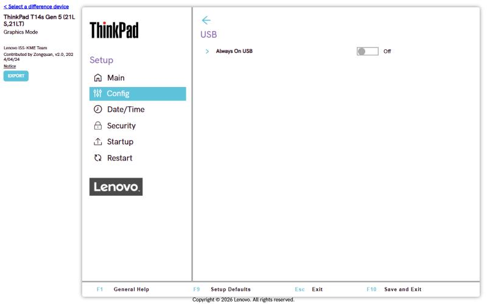

Включил обратно:

---

## Задача 7. Режим работы SATA/NVMe

Выполнить не получилось, поскольку в интерфейсе в разделе Config нет пункта Storage.

---

## Задача 8. Временное меню загрузки

Путь: Startup -> Boot Mode и Startup -> Boot device List F12 Option

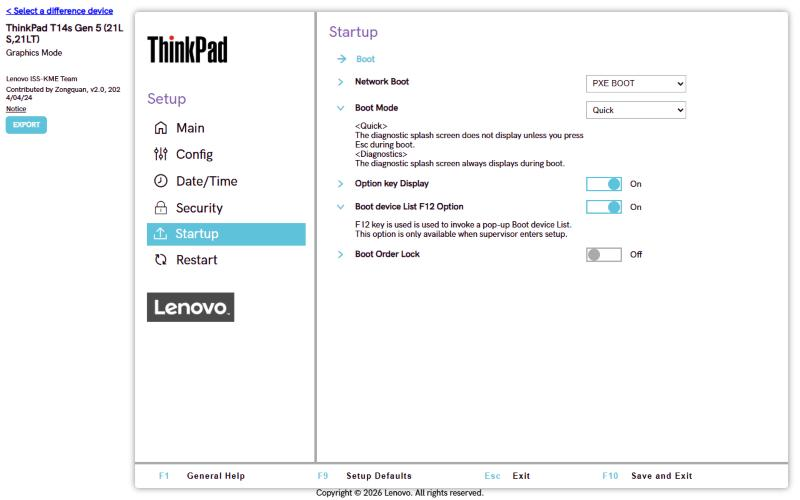

Переключил Boot Mode в Diagnostics и отключил F12 Option:

Вернул Quick и включил F12 Option:

Порядок в Startup -> Boot сохраняется и действует при каждой загрузке. Меню F12 позволяет выбрать устройство только для одной загрузки и сохранённые настройки не меняет.

---

## Задача 9. Просмотр системных логов

Путь: Main -> BIOS Event log

Раздела Config -> Diagnostics на этой модели нет. Журнал находится в Main, но симулятор его не поддерживает, пункта Clear Event Log тоже нет.

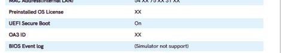

---

## Задача 10. Подготовка к переустановке ОС

Шаг 1. Сброс через Restart -> Load Factory Defaults:

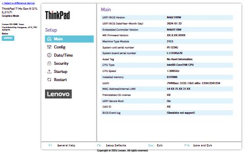

Шаг 2. Secure Boot включён:

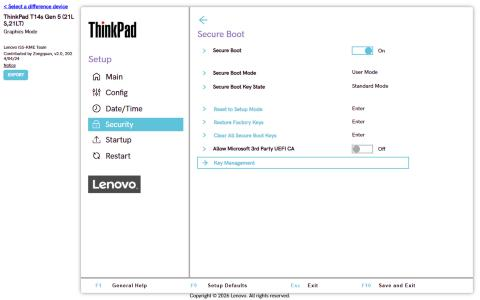

Шаг 3. Установлен Supervisor Password:

Шаг 4. USB HDD поставлен первым:

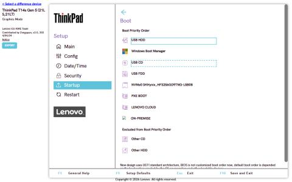

Шаг 5. Сохранение через F10:

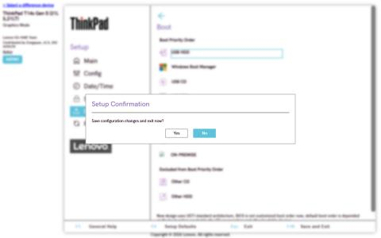

Шаг 6. Повторный вход, настройки сохранились:

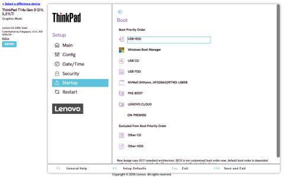

Вернул исходный порядок загрузки:

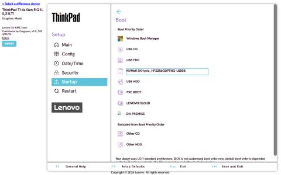

Клавиша F9 пароль не сняла:

Пароль снят через Restart -> Load Factory Defaults:

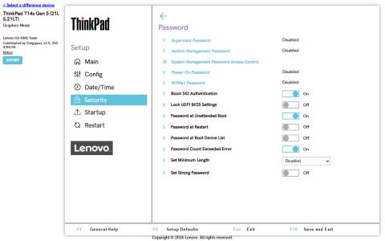

---

## Пути к настройкам

- Startup -> Boot
- Security -> Secure Boot -> Secure Boot
- Security -> Password -> Supervisor Password
- Restart -> Load Factory Defaults
- Config -> USB -> Always On USB
- Startup -> Boot Mode
- Startup -> Boot device List F12 Option
- Main -> BIOS Event log
- F9 — сброс по умолчанию, F10 — сохранить и выйти
